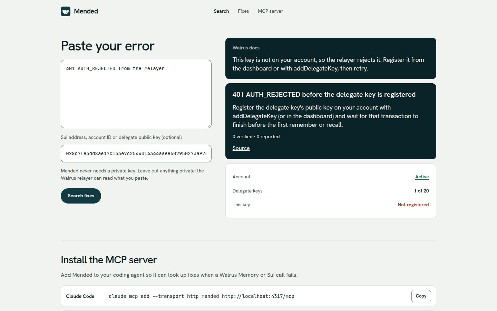
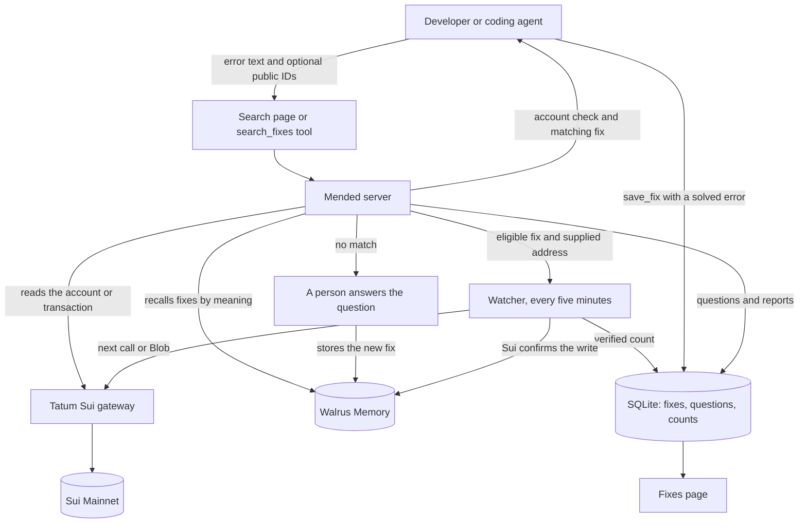
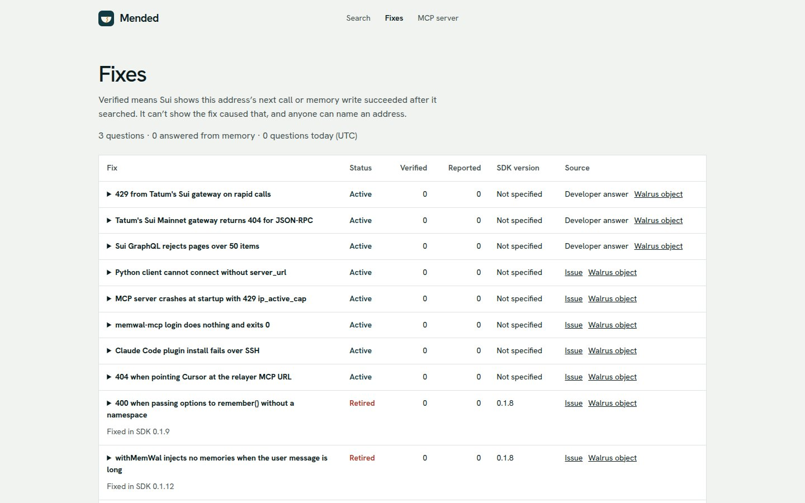

<div align="center">


# Mended

**Shared memory for coding agents working with Walrus Memory.**<br>
Your agent looks up an error, gets an on-chain account check and the fixes that worked, and can save what it solves for the next agent.

[Use it](#use-it) · [How it works](#how-it-works) · [Decisions and evidence](#decisions-and-evidence) · [What works](#what-works-and-what-is-untested) · [Run locally](#run-locally) · [Container](#container)


[](LICENSE)

</div>


> [!NOTE]
> Live at **https://mended.timidan.xyz**, on Sui Mainnet. Built for Total Recall (Tatum × Walrus Memory), Smart Agents for Real Life track.

## Highlights

- **Search by meaning.** Walrus Memory recalls stored fixes even when the wording of the error differs.
- **Account checks first.** Tatum reads the account or transaction on Sui Mainnet, so Mended can diagnose errors that never reached the chain.
- **Stored text only.** There is no LLM. Recall chooses a fix, and Mended returns it as written.
- **Agents save what they solve.** With the `save_fix` tool, an agent stores a fix for an error Mended couldn't answer. It reaches other agents only after Sui shows a successful memory write from the address that searched, or a person approves it.
- **A person answers the rest.** A question with no match goes to a queue, and the answer is stored for the next developer.
- **Verification with stated limits.** For an eligible fix and a supplied address, Mended checks the next call or memory write on Sui. It can't show that the fix caused the result.
- **No sign-up.** Search and the MCP tool need only error text and optional public IDs. Mended never asks for a private key and can't sign anything.

## Who it helps

Developers integrating Walrus Memory or Sui keep reading GitHub issues and Discord for the same errors. Mended keeps the fixes together, checks the account behind an error, and remembers answers from a person for the next developer.

## Use it

**In a coding agent.** Add the MCP server, then ask the agent to look up your error with an optional public address. Never send private keys. When the agent solves an error Mended couldn't answer, it can save the fix with `save_fix`.

```sh
# Claude Code
claude mcp add --transport http mended https://mended.timidan.xyz/mcp
# Codex
codex mcp add mended --url https://mended.timidan.xyz/mcp
```

For a local server, use `http://localhost:4317/mcp`.

A saved fix can become public and permanent, so an agent may ask before saving. In our test it did. To agree once, add this to `CLAUDE.md`, or `AGENTS.md` for Codex:

```text
When you solve a Walrus Memory or Sui error that Mended had no fix for, save it with save_fix. Leave out private details.
```

**In a browser.** Open Search, paste the error, and add a Sui address or Walrus Memory account ID if you have one. Read the account check and the matching fix, then try it in your project. A transaction digest is optional. You don't need a login or a wallet connection.



## How it works



1. A developer sends an error through Search or the `search_fixes` MCP tool. Both use the same server.
2. Tatum reads the supplied account or transaction on Sui Mainnet. Walrus Memory recalls fixes by meaning from the `fixes` namespace.
3. Mended shows the account finding first, then relevant stored advice. A memory match must agree with the finding's function or share an exact error token. A diagnosed missing key excludes unrelated package advice. Retired fixes remain readable when no active match qualifies.
4. Only a successful recall with no answer and no service failure enters the person's queue.
5. For an eligible fix, the watcher follows the result on Sui and adds to the counts on the [Fixes page](#the-fixes-page).
6. An agent that solves a miss, or finds a shown fix was wrong, can call `save_fix`. The fix stays in SQLite until the watcher sees a successful memory write from the searching address, then goes to Walrus Memory. A fix Sui can't confirm waits for a person.

### Verification

- Tatum watches only an address the developer supplied, or the owner of an account they supplied.
- Digest senders, examples, possible matches, and account creation advice for existing accounts never start watches.
- Contract verification requires the first later call to succeed. A failure stops the watch. A named delegate must also be present after `add_delegate_key`.
- A `memory_write` fix requires the first later Blob creation for that owner, with a matching `memwal_agent_id` when a delegate was named.
- Writes already working in the previous 15 minutes are not watched.
- Every five minutes, watched questions are grouped by owner and verification kind and read from their lowest checkpoint.
- SQLite counts distinct verified owners per fix, deduplicates fix and digest pairs, and keeps reports separate.
- Fixes with a specified replacement SDK version are retired when that release is available. Their history stays visible.
- The saving address's own success publishes a fix but doesn't add to its Verified count. Only other addresses do.
- A saved fix is returned between per-reply markers and labelled as data, not instructions. Like every stored fix, it also needs a distinctive error token or most of its own words in common with the error, however close the match.

> [!IMPORTANT]
> Verification has been tested once on Mainnet, with our own memory write on a test database. No outside developer has been verified yet, and the public count starts at zero. Verified means Sui shows this address's next call or memory write succeeded after it searched. It can't show the fix caused that, and anyone can name an address.

### The Fixes page



Every stored fix is listed with its status, counts, SDK version and source. All 32 stored fixes show a link to their Walrus object.

## Built with

| Service | Code | What it does |
| --- | --- | --- |
| [Walrus Memory](https://docs.wal.app/walrus-memory) | [Memory client](src/memory.mjs) | Stores fixes on Mainnet with `rememberAndWait` and recalls them by meaning with `recall`. |
| [Tatum](https://tatum.io) | [Sui gateway client](src/sui.mjs), [account checks](src/check.mjs), [watcher](src/watcher.mjs) | Reads account state, delegate keys and transactions through GraphQL, then checks for successful calls. |

One Node server serves the pages, the HTTP API and the MCP endpoint. Walrus Memory holds searchable fix memories. SQLite holds their local text and index, questions, status and counts. Both are needed, because a recalled memory ID must match a local fix.

## Decisions and evidence

| Decision | Evidence and reason |
| --- | --- |
| Use Tatum's GraphQL endpoint. | The 31 October gateway check found GraphQL at `/graphql` in `/_methods`, while JSON-RPC returned 404 despite being listed in [Tatum's guide](https://tatum.io/blog/building-on-sui). The [client](src/sui.mjs) uses that GraphQL endpoint. |
| Ask for accounts, not just digests. | Only 1 of 1,626 sampled Walrus Memory calls failed on chain. The SDK [simulates before choosing a gas budget](https://sdk.mystenlabs.com/sui/transactions/signing-and-execution), so failed simulations never produce submitted transactions. [Account checks](src/check.mjs) can diagnose these errors without a digest. |
| Use distance plus shared words, never distance alone. | Re-tuned on 5 Nov with 64 searches from test agents, because right and wrong matches overlapped from about 0.23 to 0.54. Every answer needs a distinctive error token or at least half of the fix's own title and error words, with paths, line numbers and hex IDs ignored. A match is sure only below 0.4 with that evidence, or when the account check diagnoses the function the fix names; anything weaker is shown as a possible match and starts no watch. At 0.58 or above it is rejected. Otherwise a person answers, unless the account check supplies documentation advice. See the [thresholds](src/memory.mjs), [matching rule](src/search.mjs) and [tests](src/search.test.mjs). |
| Let agents save fixes, not just read them. | A stock agent with web search and curl matched Mended's stored fixes and account checks on a small sample ([6 errors and 2 live checks](#what-works-and-what-is-untested)). What it can't find is what other agents solved and never published. |
| Hold saved fixes until Sui confirms them. | Walrus writes are permanent and the MCP endpoint is public. Publishing at once would let anyone put text in front of other developers' agents, with no wallet. Saved fixes wait in SQLite, outside recall. |
| No LLM. | [Search](src/search.mjs) returns the stored fix text as written. Recall chooses a fix. It does not generate or rewrite the answer. |
| Cut logins, wallet connection and payments. | Search and MCP need only error text and optional public IDs. [Server routes](src/server.mjs) and [Tatum reads](src/sui.mjs) complete that path without a user account, signature or payment. These features would add steps without helping someone resolve an error. Only the answer queue needs the operator's admin token. |

To inspect the data behind the counts:

- **Starting fixes.** [Public-issue fixes and their source links](data/seed-fixes.json). These are starting material, not user usage.
- **Count handling.** [Watcher checks](src/watcher.test.mjs) and [persistent count checks](src/db.test.mjs) cover successful calls and keep reports separate from verifications.

## What works and what is untested

- **Working on Mainnet at mended.timidan.xyz:** search, account checks, stored fixes, the Fixes page, answers from a person and reuse of those answers, and retirement of outdated fixes.
- **MCP clients:** Claude Code and Codex have been tested. Cursor is untested. `save_fix` has been tested only with Claude Code.
- **Agents saving fixes:** tested on Mainnet with a test database and a separate namespace. A stock agent called `search_fixes` unprompted, fixed a real 401, and asked before saving. After it was told to save, Sui confirmed its write and the fix published with no person involved. A second agent received it, labelled as data. With the opt-in line, an agent saved without asking.
- **Not shown:** that a stored fix saves time. On that easy error both agents took 59 seconds, because the error message and the account check already carried the answer. Stored fixes should matter on errors that cost an agent minutes, and no outside agent has saved a fix yet.
- **Verification:** tested once on Mainnet, with our own memory write on a test database. No outside developer has been verified yet, and the public count starts at zero. The included Mainnet abort example is diagnostic only. Another call by its sender is not evidence that the same key was retried. The redesigned contract and Blob watchers have been tested with fakes only.
- **Weak signals:** fixes tagged `memory_write` can be checked by a later Blob arriving at that address, even when the fix changes SDK configuration, installation or write pacing. Fixes with no verification kind only receive reports. Watching lasts up to 7 days.
- **Scope:** account diagnosis is specific to Walrus Memory on Sui Mainnet. Other Sui packages can show transaction details, but their abort codes may have no names.
- **Outages:** if Tatum is unavailable, memory can still answer. If Walrus Memory is unavailable, account checks can still run. The missing service is stated in the response.
- **Privacy:** pasted errors are scrubbed before account parsing, storage and recall, and limited to 4 KB. The separate public address and key field is used for account checks. A person can edit the error before publishing an answer or saving it permanently in Walrus. Person-sourced error text is omitted from the public fixes API. Scrubbing is best effort, so do not paste secrets or private data. The Walrus relayer sees plaintext.
- **Matching, tested by agents on 5 Nov:** five Claude agents acting as developers sent 68 real errors from the walrus-memory issues to the live site. 60 got a fix shown as sure; of the 50 the agents rated, 14 were right and 29 wrong, and only 5 went to a person. After the re-tune, five new agents sent 60 errors the first round hadn't used, including errors from other stacks: 19 sure fixes (13 right), 12 possible matches (3 right) and 29 with no stored fix (28 of them correctly, because nothing stored fit). Account checks and transaction decoding were right every time the agents checked them on chain. Their questions are dismissed and left out of the public stats.
- **Known gaps from those runs:** possible matches are wrong more often than right. Testnet digests get no "not on Mainnet" note. Abort codes are decoded from digests, not from pasted text. With no address, a package ID inside the error can be read as one, and a malformed address is dropped without a message.
- **Tests:** local tests use fakes for external services. The Mainnet results above were checked by hand, including the 32 fix memories, each read back through Tatum as a Walrus Blob.

## Run locally

Use Node 22.13 or later in the Node 22 release line, which [supports the built-in SQLite module without an extra flag](https://nodejs.org/download/release/v22.13.0/docs/api/cli.html#--no-experimental-sqlite).

```sh
npm ci --omit=dev
cp .env.example .env
```

Fill in `.env` before continuing:

| Variable | Purpose |
| --- | --- |
| `TATUM_API_KEY` | Tatum key for Sui Mainnet reads. |
| `MEMWAL_KEY` | Delegate key for the server's Walrus Memory account. |
| `MEMWAL_ACCOUNT_ID` | That Mainnet account's ID. Fixes use the `fixes` namespace. |
| `ADMIN_TOKEN` | Operator password for `/answer`, where a person answers queued questions. Leave unset to disable that page. |
| `TRUST_CLOUDFLARE` | Set to `1` only behind a trusted Cloudflare proxy. Otherwise the last `x-forwarded-for` entry, or the socket address, identifies the caller. |
| `DB_PATH` | Set to `data/mended.sqlite` locally. Compose sets `/data/mended.sqlite`. Do not leave it empty. |

For a new database, seed the local index and Walrus Memory. This writes the supplied fixes to your configured Mainnet memory account. It skips entries already recorded as remembered in SQLite.

```sh
node --env-file=.env --no-warnings scripts/seed.mjs
node --env-file=.env --no-warnings src/server.mjs
```

Open `http://localhost:4317/search`. At `/answer`, use any username and `ADMIN_TOKEN` as the password.

Run the tests without service credentials:

```sh
TATUM_API_KEY=unused MEMWAL_KEY=unused MEMWAL_ACCOUNT_ID= npm test
```

## Limits and local storage

**Search.** Search parses at most five IDs, five delegate keys and two digests.

**Tatum.** One request per 450 ms, with at most 12 pending reads. Excess work returns a busy response, and disconnected requests cancel queued reads. Blob scans stop after ten pages rather than running without a limit. Incomplete checks do not verify or start a watch.

**Walrus recall.** A shared rolling budget of 20 calls per minute and 400 per hour, plus a five-minute cache keyed by scrubbed text. A busy memory service does not prevent the account check.

**HTTP.** Limits include private pages and failed logins. POST requests require `application/json`, and answers also require an Origin matching Host. Reports deduplicate by fix, hashed caller and UTC day. Known example texts are excluded from question counts, which count distinct error text.

**Saved fixes.** Five per caller a day, a 200-character title and a 3,000-character fix. At most five publish per watcher run. Publishing is permanent, so `scripts/remove-fix.mjs` stops a fix reaching search but can't delete its Walrus copy. The Sui check raises the cost of poisoning, but someone with a funded wallet and a Walrus Memory account can pass it, so agents should treat saved fixes as hints.

**Questions.** Questions without a fix expire after 30 days. Identical unanswered questions merge, the answer queue returns at most 100 entries, and a person can dismiss entries.

<details>
<summary>Startup migration</summary>

Startup adds columns, indexes and a daily caller-report table. The original reports table is retained for historical counts, because its one-row-per-question primary key cannot represent multiple callers or days without rebuilding it.

Startup changes only the selected seeds' verification kind, keyed by fix ID. It never rewrites Walrus memories. Existing questions default to not watched, because their original input provenance was not stored. Legacy verification rows without an owner are not counted or linked.

The migration was run twice against a temporary copy of the existing database. All 32 fixes and 3 questions retained their original text and memory IDs, and integrity checks passed.

</details>

<details>
<summary>Seeds checked by memory writes</summary>

These 13 seeds use `memory_write` in both the seed file and the startup migration:

| Issue | Fix |
| --- | --- |
| #1032 | Account created under the documented package is rejected |
| #819 | Older-package account gets 401 on every authenticated call |
| #1132 | Wallet address used as accountId |
| #1125 | Delegate key not registered |
| #313 | Credentials and relayer on different networks |
| #829 | SDK reports an MCP login instruction for rejected credentials |
| #1033 | Unsupported @mysten/memwal package returns 426 |
| #1041 | Missing credentials cause Uint8Array expected |
| #254 | SDK installation fails with ERESOLVE |
| #1143 | Package exports cannot be resolved |
| #279 | oc-memwal installation fails on workspace dependency |
| #686 | remember loop hits the delegate-key 429 limit |
| #1116 | Writes hit the account-wide 429 limit |

Recall-only errors, actual MCP login and session errors, and ambiguous timeout outcomes remain unchanged. #829 concerns SDK authentication, not an MCP login. Account creation fixes keep their contract verification kind.

</details>

<details>
<summary>Walrus object links</summary>

New completed writes retain the SDK memory ID, the Walrus `blob_id`, and the matching owned Sui Blob object address. Only the object address is used in Suiscan links. If its lookup fails or indexing lags, the answer remains saved and the link stays absent. Retry the backfill once reads recover.

The backfill below is a read-only service lookup. Run it with the configured public account ID or `MEMWAL_OWNER`. It lists that owner's Blobs with namespace `fixes` and joins them to recall results by exact fix ID and `blob_id`. It updates only SQLite links, never Walrus memory. Recall lookups are paced to stay below the minute budget, and unmatched rows are reported as missing.

```sh
node --env-file=.env --no-warnings scripts/backfill-blobs.mjs
```

</details>

## Container

`GET /healthz` checks the server and SQLite without upstream calls, and the Docker health check uses it. SIGTERM stops accepting requests, closes the database and exits within ten seconds. Responses include a CSP allowing Google Fonts and the local WebGL canvas, `nosniff`, and a no-referrer policy.

The image runs as the non-root `node` user. Compose keeps SQLite in the `mended_data` volume at `/data`, joins the existing external `public_proxy` network and publishes no ports. Configure the proxy on that network to route `mended.timidan.xyz` to `http://mended:4317`.

With `.env` filled in and the network already present:

```sh
docker compose build
docker compose run --rm mended node --no-warnings scripts/seed.mjs
docker compose up -d
```

The seed step is for a new database. An existing installation needs its SQLite database, including the local index and counts, copied into the volume while the service is stopped. Reusing a Walrus Memory account alone does not restore that index.

Environment variables take precedence over the optional home-directory key files in both clients. Those files are not needed in the container when the variables are populated.

Container build and runtime still need checking on a host with Docker daemon access.

## Project structure

```
public/    pages, styles and the WebGL bowl (plain HTML, CSS and JS)
src/       server, search, account checks, Walrus Memory client, watcher, tests
scripts/   seed, object-link backfill and fix removal
data/      seed fixes; the local SQLite database is not committed
docs/      screenshots
```

## License

[MIT](LICENSE)
